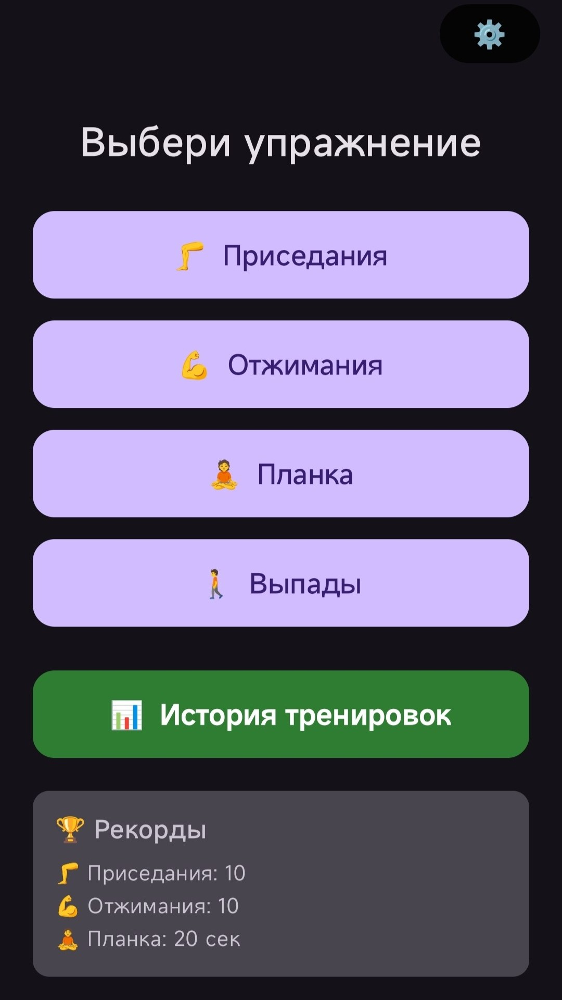
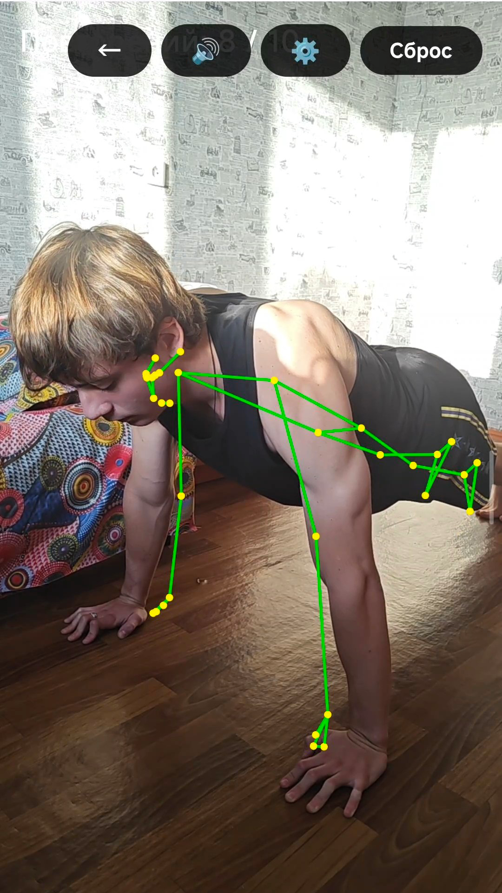
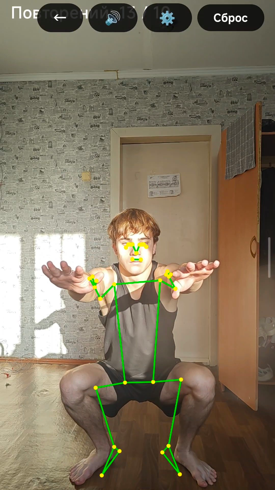
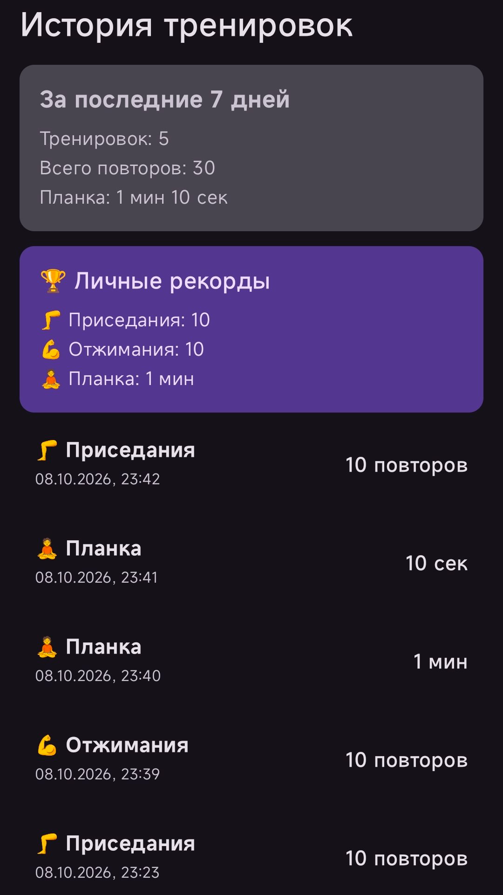

# Форма — AI exercise form coach

**ИИ-тренер по технике упражнений для Android**

Считает повторы, следит за техникой и голосом подсказывает, что исправить.

## О проекте

**«Форма»** — Android-приложение для домашних тренировок, которое анализирует технику упражнений через камеру телефона в реальном времени. Приложение использует **MediaPipe Pose Landmarker** для распознавания позы, **CameraX** для работы с камерой, **TextToSpeech** для голосовых подсказок и **Room** для хранения истории тренировок.

Поддерживаются 4 упражнения:

- 🦵 Приседания (ракурс — спереди)

- 💪 Отжимания (ракурс — вполоборота ~60°)

- 🧘 Планка (ракурс — сбоку)

- 🚶 Выпады (ракурс — вполоборота ~60°)

## Возможности

- **Счёт повторов в реальном времени** — без кнопок и нажатий

- **Контроль техники** — глубина приседа, линия тела, угол локтя, наклон спины

- **Голосовые подсказки** — «Держи спину», «Глубже», «Пятки на полу», «Хорошо»

- **Защита от ложных срабатываний** — гистерезис фаз + проверки положения тела

- **История тренировок** — все подходы сохраняются локально (Room)

- **Личные рекорды** — по каждому упражнению

- **Streak** — серия дней подряд с тренировками

- **Тёмная / светлая / системная тема**

- **Вибрация при счёте повторов** (опционально)

- **Полностью офлайн** — без интернета и без сбора данных

- **Русский голос и интерфейс**

## Стек технологий

- **Kotlin** — 2.2.10

- **Android Gradle Plugin** — 9.2.0

- **Jetpack Compose** — BOM 2026.02.01

- **CameraX** — 1.5.0

- **MediaPipe Tasks Vision** — 0.10.0

- **Room** — 2.8.5

- **Accompanist Permissions** — 0.37.3

- **KSP** — 2.3.12

- **compileSdk / targetSdk** — 37

- **minSdk** — 26 (Android 8.0)

- **NDK** — только arm64-v8a

- **Java** — 11

## Ключевые технические решения

**1. Гистерезис фаз.** Разные пороги для входа и выхода из фазы + подтверждение фазы несколькими кадрами подряд. Это устранило ложные срабатывания от шума MediaPipe.

**2. Проверки положения тела.** Вертикальная цепочка (нос — бёдра — колени — стопы), минимальная длина ноги, минимальное расстояние между коленями. Отсекает случайные объекты в кадре.

**3. Максимум углов локтя для отжиманий.** Вместо среднего значения между левым и правым локтем — берётся максимум.

**4. CPU-делегат MediaPipe.** Обязателен для стабильности на Snapdragon 8 Gen 2. GPU-делегат вызывал SIGSEGV.

**5. Только arm64-v8a.** Ограничение ABI через abiFilters.

## Как запустить

**Требования:**

- Android Studio 2026.1.4 или новее

- JDK 11

- Телефон на arm64-v8a

- Android 8.0+

**Сборка:**

1. Клонировать репозиторий: `git clone https://github.com/vladostorobev1-afk/StudentUse.git`

2. Открыть проект в Android Studio

3. Build → Build Bundle(s) / APK(s) → Build APK(s)

4. Установить APK на телефон

**Важно:** приложение собирается только через APK, не через Studio Run.

## Скриншоты

## Статус

- ✅ Все 4 упражнения работают

- ✅ История, рекорды, streak

- ✅ Тёмная / светлая темы

- ✅ Голосовые подсказки

- ✅ Вибрация при счёте

- ⏳ Публикация в RuStore (в процессе)

## Контакты

- **Автор:** Владислав Воробьёв

- **Email:** vladostorobev1@gmail.com

- **GitHub:** [@vladostorobev1-afk](https://github.com/vladostorobev1-afk)
